# Introdução

Informações básicas do projeto.

<<<<<<< HEAD
* **Project:** MatchService2.0
* **GitHub Repository:** [LINK](https://github.com/ICEI-PUC-Minas-PPLCC-TI/ti1-g-prestadores-de-servico)
* **Team Members:**

  * [Henrique Pimenta Krueger](https://github.com/HenriquePkrueger)
  * [Rhayner Moura Martins da Silva Araújo](https://github.com/rhaynermartins)
  * [Samuel Elias Santos Oliveira](https://github.com/SamuelMonstewe)
  * [Gabriel Ulhoa Thebaldi](https://github.com/gauthzera)
=======
- **Projeto:** PRESTADORES DE SERVIÇO
- **Membros da equipe:**
  - [Rhayner Moura Martins da Silva Araújo](https://github.com/rhaynermartins)
  - [Henrique Pimenta Krueger](https://github.com/HenriquePkrueger)
  - [Samuel Elias Santos Oliveira](https://github.com/SamuelMonstewe)
  - [Gabriel Ulhoa Thebaldi](https://github.com/gauthzera)

A documentação do projeto está estruturada da seguinte forma:
>>>>>>> 1f8d56a (docs: update README)

1. Introdução
2. Contexto
3. Product Discovery
4. Product Design
5. Metodologia
6. Solução
7. Referências Bibliográficas

✅ [Documentação de Design Thinking (Miro)](files/processo-dt.pdf)

# Contexto

Detalhes sobre o problema, os objetivos do projeto, sua justificativa e seu público-alvo.

## Problema

Na sociedade da era da informação, em que os profissionais se especializam cada vez mais em áreas específicas do conhecimento e o tempo se tornou um recurso extremamente valioso, algumas tarefas cotidianas que antes eram consideradas simples acabam se tornando desafiadoras.

Um exemplo claro desse cenário é o gerenciamento de reparos domésticos. Não é raro ouvir relatos de pessoas que não conseguem conciliar, por exemplo, um reparo hidráulico ou elétrico com uma jornada de trabalho integral.

Essas dificuldades não se limitam à questão dos horários, mas também envolvem a dificuldade de encontrar um profissional adequado, verificar se ele possui boas referências e até mesmo determinar qual seria um preço justo para cada serviço.

Dessa forma, é natural recorrer às ferramentas da era da informação para enfrentar esse problema.

## Objetivos

A finalidade desta aplicação é lidar com o problema descrito anteriormente, conectando a demanda dos consumidores por serviços às oportunidades de renda extra para os prestadores. Tudo isso com o objetivo de oferecer praticidade e segurança para ambas as partes.

A solução consiste em um aplicativo que atua em duas frentes principais: tempo e expertise.

<<<<<<< HEAD
The solution takes the form of an application t[Samuel Vitor Vieira](https://github.com/svsamuel1912)hat operates on two main fronts: time and expertise.
    • Time: the app allows consumers to schedule services outside regular business hours, fitting them better into their routines, while also giving service providers the opportunity to increase their income.
    • Expertise: in addition to connecting consumers and service providers, the application provides relevant information for more informed decisions, such as reviews, portfolios, and quotes.
=======
- **Tempo:** o aplicativo oferece ao consumidor a possibilidade de agendar serviços fora do horário comercial, adaptando-os melhor à sua rotina. Ao mesmo tempo, proporciona ao prestador a oportunidade de ampliar sua renda.
- **Expertise:** além de aproximar consumidores e prestadores, a aplicação disponibiliza informações relevantes para uma tomada de decisão mais consciente, como avaliações, portfólios e orçamentos.
>>>>>>> 1f8d56a (docs: update README)

## Justificativa

Quase todo mundo já enfrentou, ou conhece alguém que enfrentou, situações relacionadas a reparos domésticos. Para compreender melhor o problema, buscou-se organizar e analisar as principais demandas, dificuldades e soluções desejadas.

A partir de pesquisas com consumidores e prestadores de serviços, identificou-se uma demanda significativa por reparos realizados fora do horário comercial, assim como a disponibilidade de profissionais interessados em atender a essa necessidade.

Três pontos se mostraram centrais:

1. **Dificuldade de encontrar prestadores qualificados:** esse é um dos principais aspectos a serem trabalhados, por meio da conexão entre as partes e da disponibilização de informações úteis, como avaliações, portfólios e orçamentos.
2. **Velocidade e proximidade:** são prioridades para os usuários, que buscam agilidade na prestação dos serviços. Nesse sentido, filtros inteligentes permitem que encontrem profissionais de acordo com suas necessidades e localização.
3. **Outras dificuldades recorrentes:** incluem a necessidade de orçamentos prévios para ajudar a avaliar a justiça dos preços, um sistema de reputação para fortalecer a confiança entre os usuários e filtros adicionais, como o de gênero, para proporcionar maior segurança a consumidores e prestadores.

## Público-alvo

O público-alvo pode ser representado por três personas principais:

1. **Prestador de serviços:** profissionais autônomos que desejam gerar renda extra ou expandir sua clientela. Costumam conquistar clientes por indicação ou por meio de contatos de seus trabalhos fixos. Com o aplicativo, poderão selecionar trabalhos de forma mais prática, de acordo com critérios pessoais, o que representa um benefício significativo.

2. **Consumidor sem tempo:** pessoas que, devido a rotinas intensas, não conseguem resolver problemas domésticos durante o horário comercial. Suas principais dificuldades são encontrar profissionais confiáveis, compreender quais seriam os preços justos e sentir-se seguras durante o processo de contratação. O aplicativo contribui ao oferecer filtros que permitem encontrar prestadores rapidamente, sem abrir mão de informações essenciais, como orçamentos e avaliações.

3. **Consumidor sem expertise:** indivíduos que dispõem de tempo, mas não possuem habilidades para realizar reparos, mesmo os mais simples. Para esse público, o aplicativo agrega valor ao fornecer informações sobre os profissionais, orçamentos prévios e filtros adicionais, como o de gênero, reforçando a confiança no processo de contratação.

# Product Discovery

## Etapa de Entendimento

### Mapa de Stakeholders

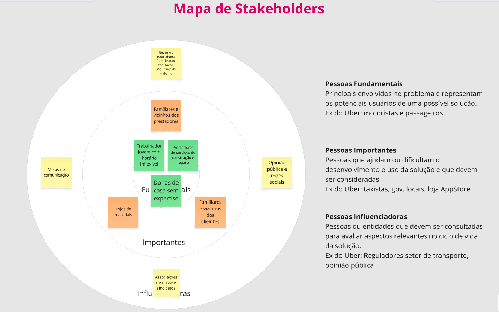

### Matriz CSD

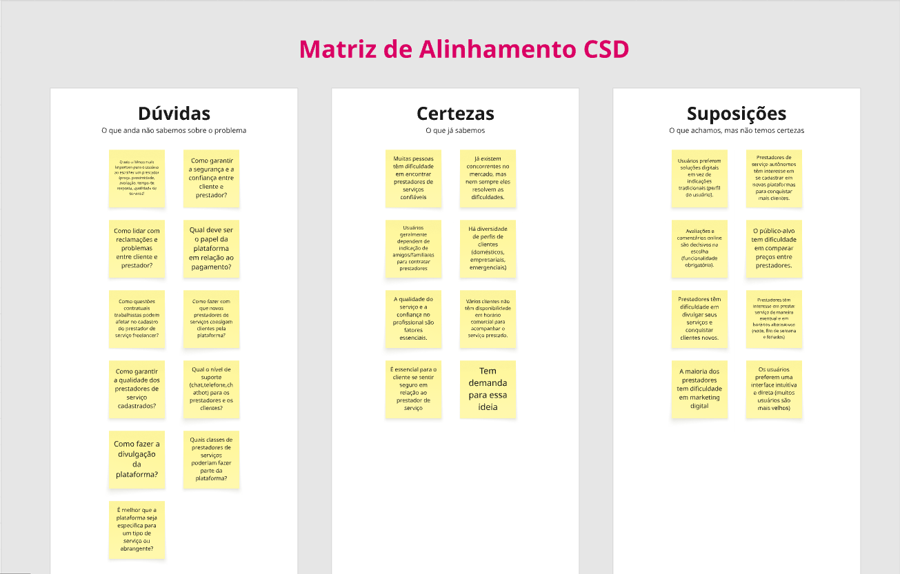

## Etapa de Definição

### Personas

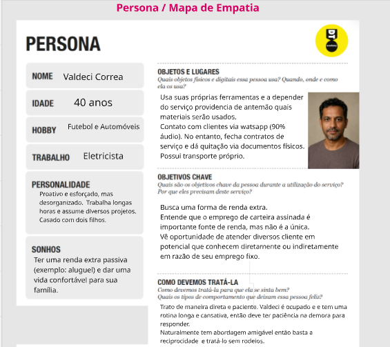

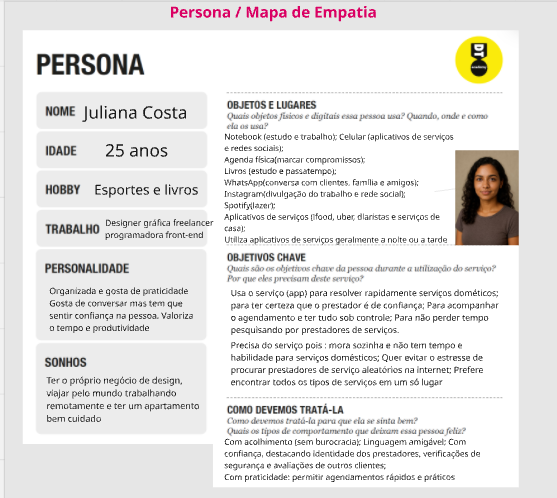

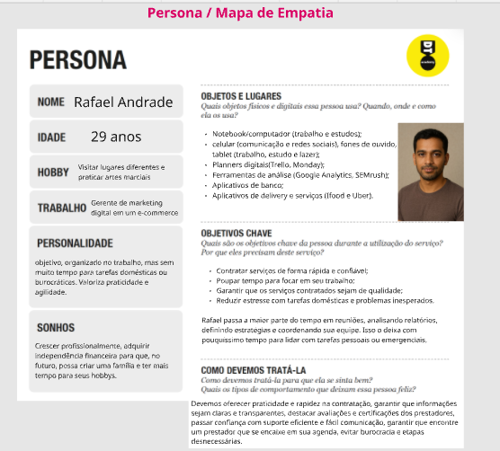

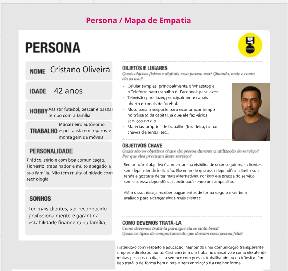

# Product Design

Nesta etapa, os insights e as validações obtidos são transformados em soluções tangíveis e utilizáveis.

Essa fase envolve a definição de uma proposta de valor, a priorização das ideias e a criação de wireframes, mockups e protótipos de alta fidelidade que representem a interface e a experiência do usuário.

## Histórias de usuários

Com base na análise das personas, foram identificadas as seguintes histórias de usuários:

| EU COMO... `PERSONA` | QUERO/PRECISO... `FUNCIONALIDADE` | PARA... `MOTIVO/VALOR` |
|---|---|---|
| Eletricista | Preciso de uma agenda para organizar meus horários. | Para encontrar clientes cujas localizações e necessidades sejam compatíveis com meu perfil. |
| Gerente de e-commerce | Preciso de uma funcionalidade que mostre profissionais de confiança capazes de resolver meu problema fora do horário comercial. | Para receber atendimento fora do horário comercial de um profissional confiável. |
| Programadora freelance | Preciso de uma funcionalidade que mostre prestadores com boas avaliações, considerando que sou mulher e moro sozinha. | Para encontrar rapidamente, em um só lugar, um profissional confiável ou com boa reputação, inclusive para atendimentos fora do horário comercial. |
| Marceneiro | Preciso de uma funcionalidade que aumente a visibilidade dos meus serviços na plataforma. | Para encontrar clientes em potencial que precisam dos meus serviços, mas têm dificuldade em localizar profissionais disponíveis fora do horário comercial. |

## Proposta de valor

### Proposta de valor para Valdeci

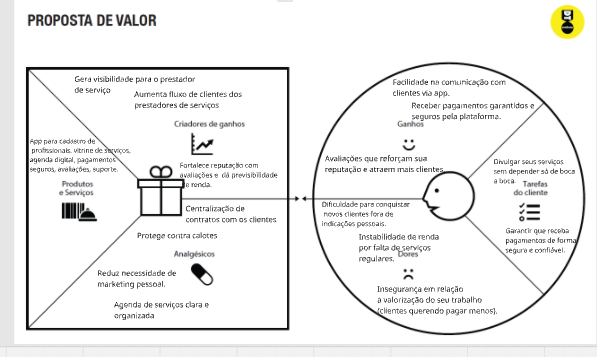

### Proposta de valor para Juliana

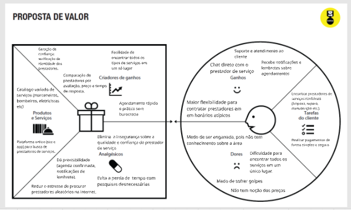

### Proposta de valor para Rafael

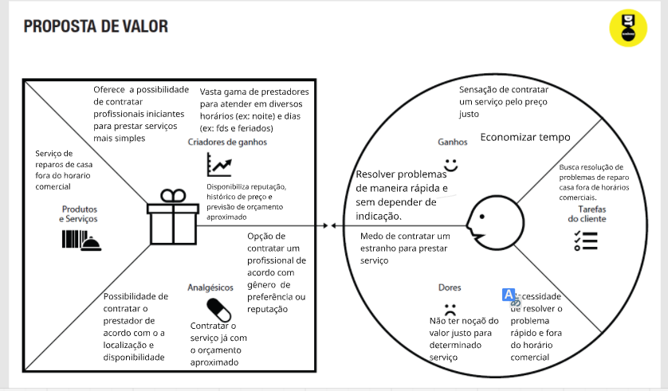

## Requisitos

As tabelas a seguir apresentam os requisitos funcionais e não funcionais que definem o escopo do projeto.

### Requisitos funcionais

| ID | Descrição do requisito | Prioridade |
|---|---|---|
| RF-001 | **Cadastro de usuários:** o sistema deve permitir o cadastro de prestadores de serviços, armazenando nome, e-mail, telefone, área de atuação, localização e informação sobre a disponibilidade para trabalhar fora do horário comercial. A área de atuação deve ser selecionada a partir de uma lista de opções. A localização é necessária para permitir a filtragem por proximidade. | ALTA |
| RF-002 | **Agenda de serviços:** o sistema deve disponibilizar uma agenda na qual o prestador possa adicionar e visualizar seus serviços agendados. Para isso, deve ser utilizado o plugin JavaScript FullCalendar. Essa funcionalidade também é necessária para permitir a filtragem por disponibilidade de horários. | ALTA |
| RF-003 | **Busca e filtragem:** o sistema deve permitir que o cliente pesquise por tipo de serviço, como encanamento e reparos de móveis, e filtre os resultados por localização. | MÉDIA |
| RF-004 | **Filtro por disponibilidade:** o sistema deve permitir a busca por prestadores disponíveis em determinado intervalo de tempo. Esse requisito depende da implementação do RF-002. | MÉDIA |
| RF-005 | **Gerenciamento de disponibilidade:** o prestador deve poder gerenciar sua agenda de forma flexível, incluindo horários disponíveis para serviços extras, como trabalhos aos fins de semana ou após o expediente. | ALTA |
| RF-006 | **Ordenação por avaliação:** o sistema deve disponibilizar uma área que apresente os prestadores de serviços disponíveis, ordenados de acordo com suas avaliações. | MÉDIA |
| RF-007 | **Solicitação de serviço:** o cliente deve poder enviar uma solicitação descrevendo o problema e informando sua disponibilidade de horários. | BAIXA |
| RF-008 | **Notificações:** o sistema deve notificar o prestador e o cliente quando houver uma nova solicitação, confirmação ou mensagem. | BAIXA |
| RF-009 | **Busca por proximidade e tipo de serviço:** o sistema deve oferecer um mecanismo de busca que permita ao cliente encontrar profissionais de acordo com a proximidade e o tipo de serviço, de maneira semelhante à busca realizada em ferramentas como o Google. | MÉDIA |
| RF-010 | **Negociação e agendamento:** o prestador e o cliente devem poder aceitar ou recusar solicitações e combinar os horários diretamente pelo sistema. | BAIXA |
| RF-011 | **Redução de faltas e atrasos:** o sistema deve oferecer funcionalidades que ajudem a reduzir faltas e atrasos, como mecanismos de confirmação e lembretes para ambas as partes. | BAIXA |

### Requisitos não funcionais

| ID | Descrição do requisito | Prioridade |
|---|---|---|
| RNF-001 | **Responsividade:** o software deve ser responsivo, permitindo seu uso em celulares, tablets e computadores. | ALTA |
| RNF-002 | **Tecnologia:** o front-end deve ser implementado utilizando HTML, CSS e JavaScript. | ALTA |
| RNF-003 | **Qualidade do código:** o código deve ser modular, bem documentado e versionado, facilitando sua manutenção e a realização de correções. | ALTA |
| RNF-004 | **Disponibilidade:** o sistema deve estar disponível 24 horas por dia, sete dias por semana. | BAIXA |
| RNF-005 | **Usabilidade:** a interface deve ser intuitiva, com navegação simples, textos claros e cores que facilitem a leitura. | BAIXA |
| RNF-006 | **Acesso seguro:** o sistema deve ser disponibilizado por meio do protocolo HTTPS, garantindo uma comunicação segura entre os usuários e a aplicação. | BAIXA |

## Projeto de interface

Esta seção apresenta os artefatos relacionados à interface e à interação dos usuários com a solução proposta.

### Wireframes

Os wireframes a seguir representam as principais telas do sistema.

#### Tela de cadastro de prestador

Nesta tela, os prestadores poderão cadastrar seus perfis na plataforma.

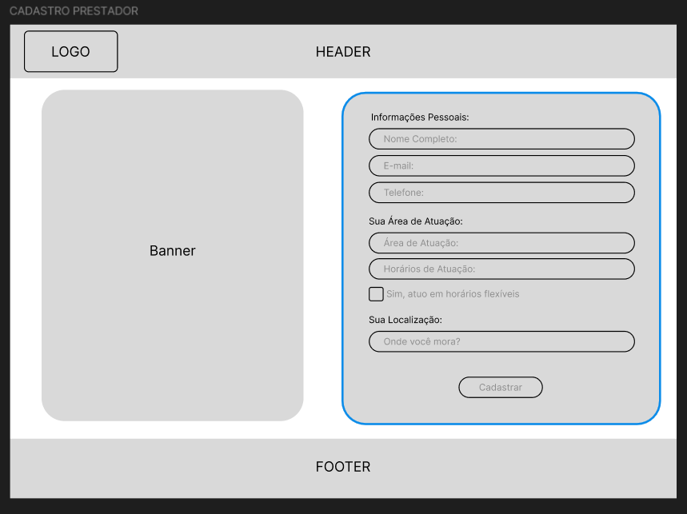

#### Landing page

Esta tela representa a página principal do site.

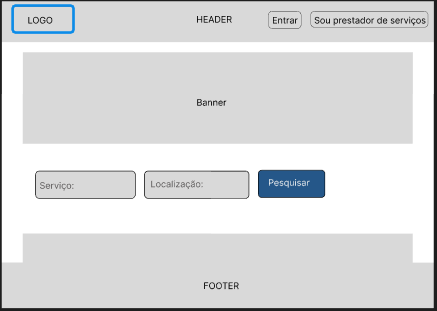

#### Tela de visualização do prestador de serviços

Nesta tela, os usuários poderão visualizar o perfil de um prestador e solicitar seus serviços.

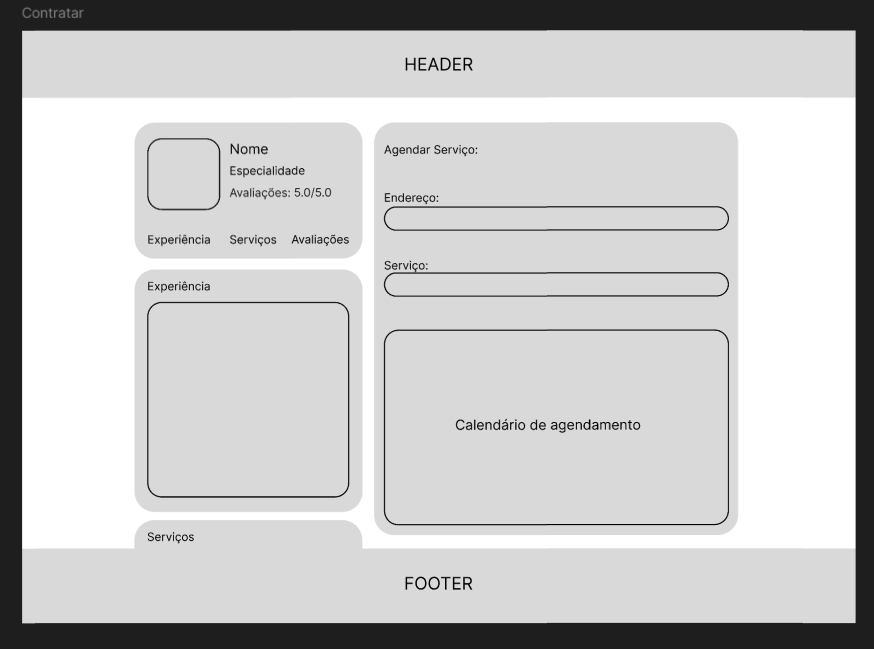

#### Tela de cadastro geral

Esta tela permite que os usuários se cadastrem no site, escolhendo entre as opções de prestador de serviços e usuário comum.

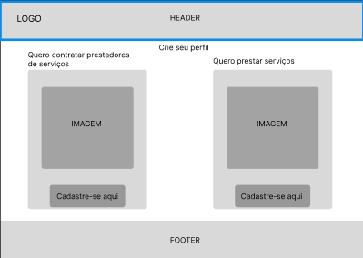

#### Tela de cadastro do usuário comum

Esta tela permite que um usuário comum se cadastre na plataforma.

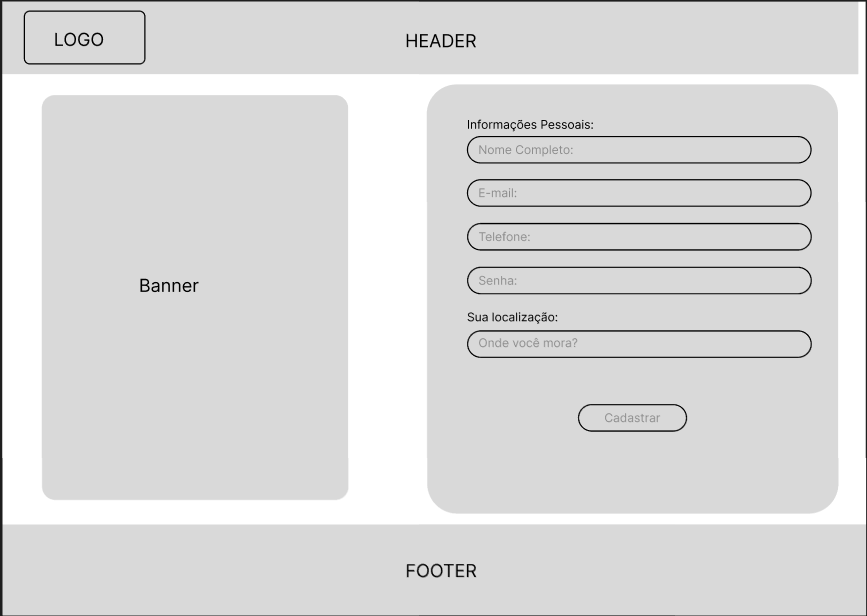

#### Tela de listagem dos prestadores de serviços

Esta tela permite que os usuários visualizem os prestadores de serviços e filtrem os resultados de acordo com os critérios da plataforma.

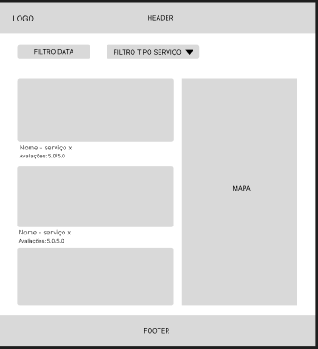

### Fluxo de navegação

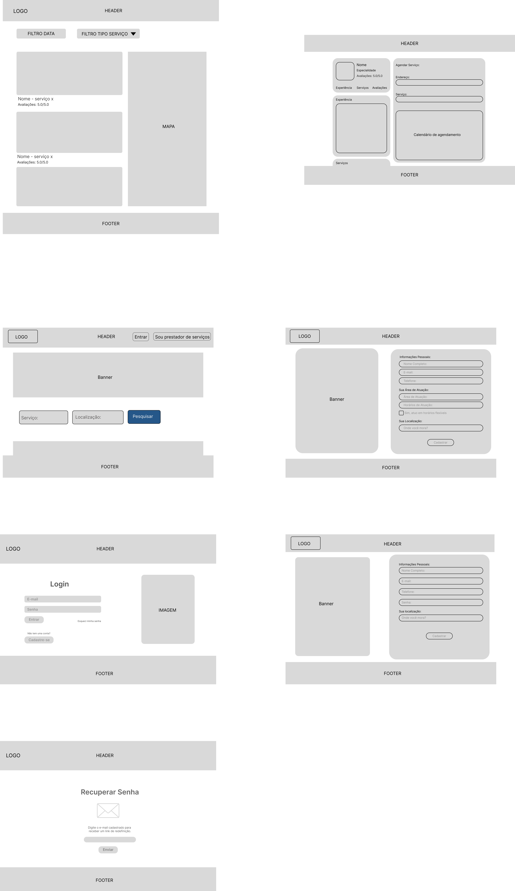

### Protótipo interativo

✅ [Protótipo interativo (MarvelApp)](https://marvelapp.com/prototype/34h4hae6/screen/97838948)

# Metodologia

Inicialmente, utilizamos a metodologia Design Thinking para estruturar o problema. Os integrantes da equipe se reuniam uma vez por semana e dedicavam a maior parte da tarde à análise do problema, à discussão de ideias e à definição dos próximos objetivos, facilitando o desenvolvimento da proposta.

## Ferramentas

Relação das ferramentas utilizadas pela equipe ao longo do projeto.

| Finalidade | Plataforma | Link de acesso |
|---|---|---|
| Processo de Design Thinking | Miro | [Miro](https://miro.com/app/board/uXjVKn8rbf4=/) |
| Repositório de código | GitHub | [Repositório GitHub](https://github.com/ICEI-PUC-Minas-PPLCC-TI/ti1-g-prestadores-de-servico) |
| Protótipo interativo | MarvelApp | [Protótipo interativo](https://marvelapp.com/prototype/34h4hae6/screen/97838948) |